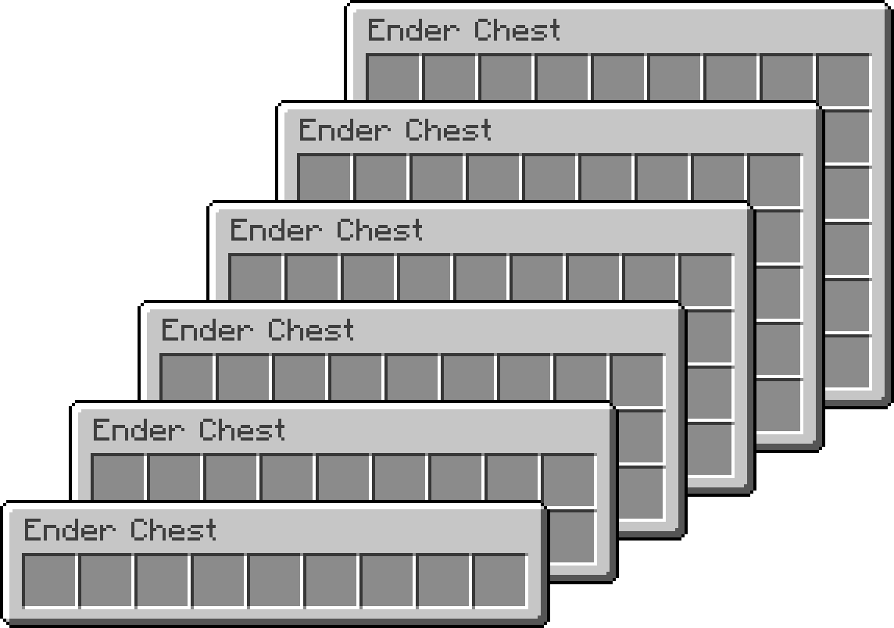
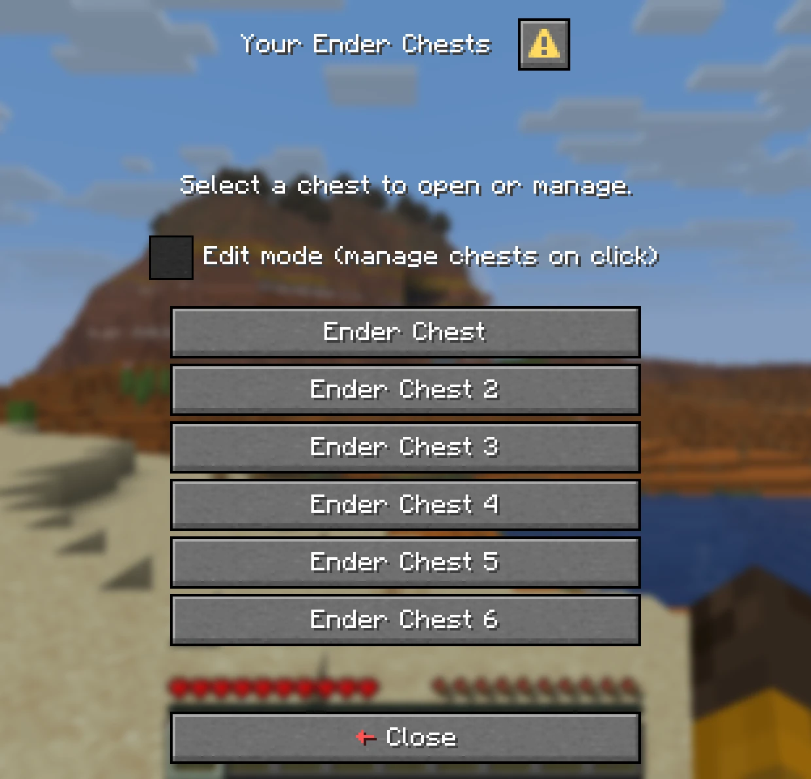
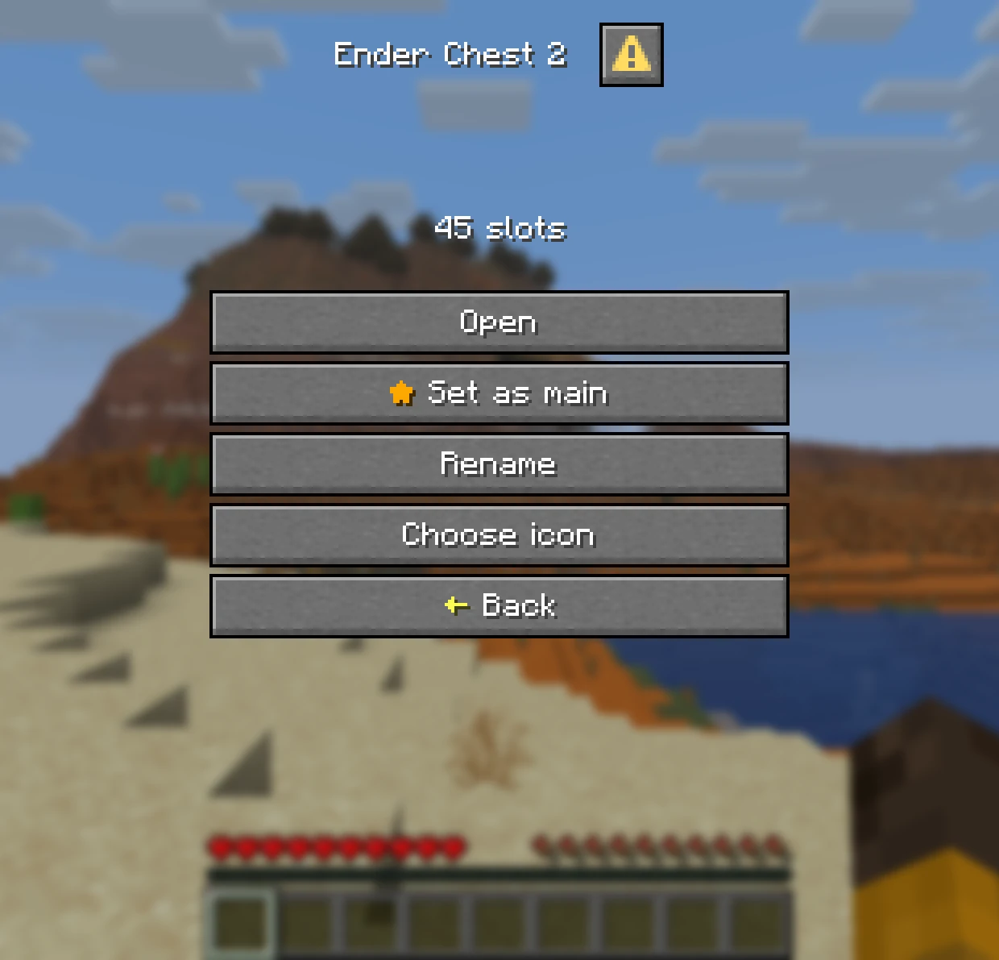
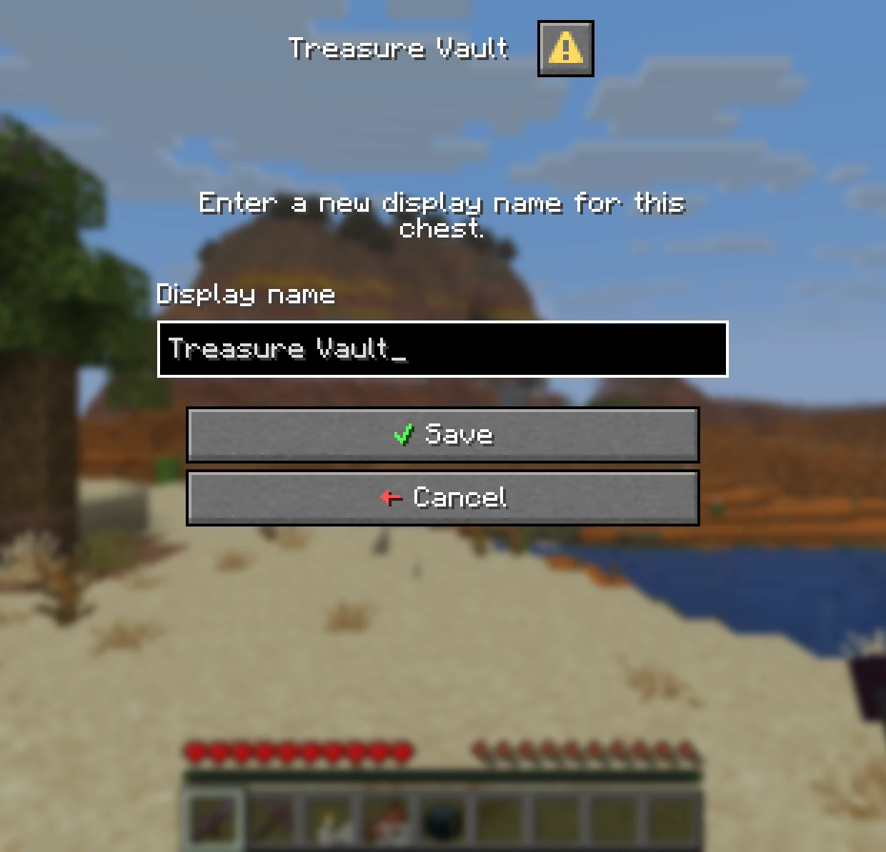
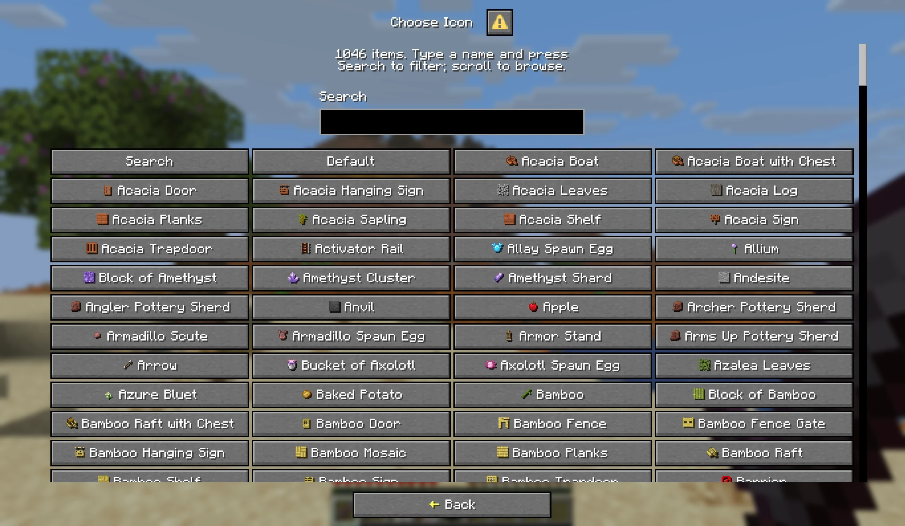
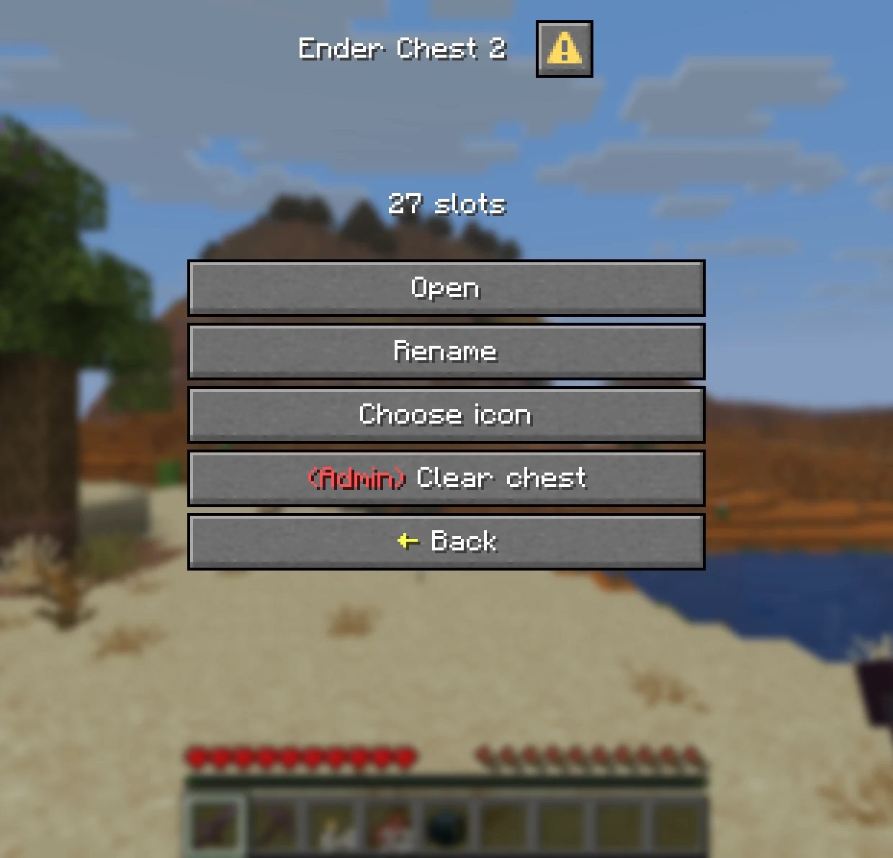
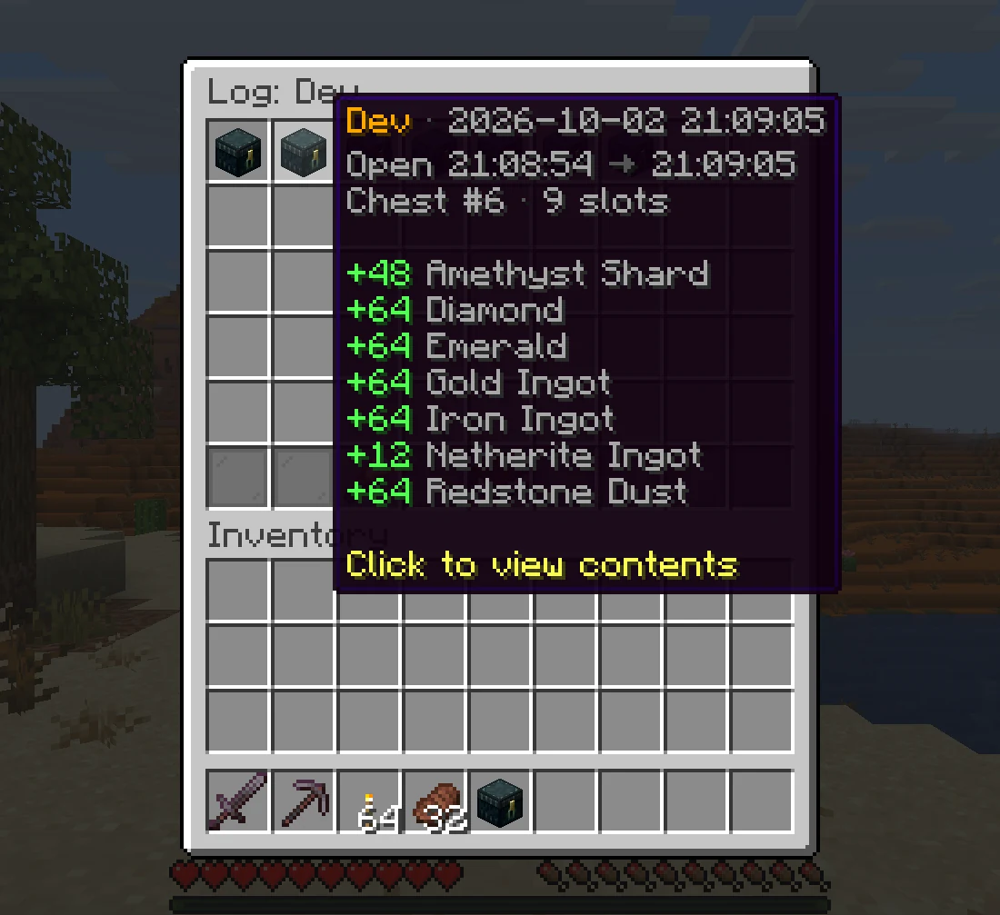
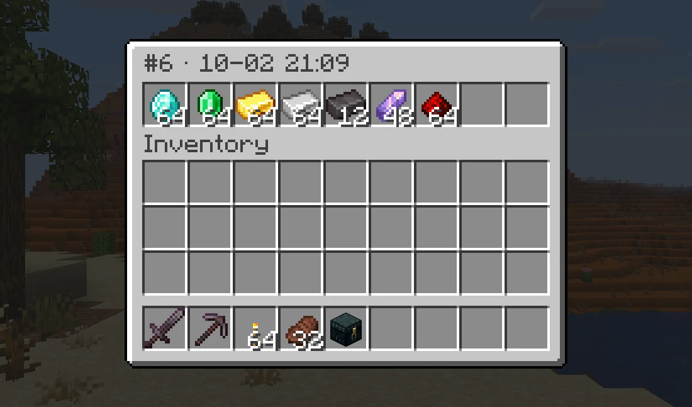
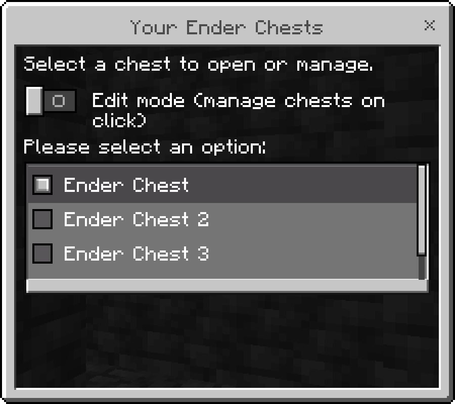

<div align="center">

<br>

[](https://modrinth.com/plugin/enhancedechest)
[](https://hangar.papermc.io/Nighter/EnhancedEchest)
[](https://openvdra.github.io/EnhancedEchest/)

</div>

## Larger Ender Chests
* **Up to 54 Slots:** A full double chest instead of 27, in steps of 9.
* **Same Block:** Right-click an ender chest or run `/ec`. The lid still opens and closes.
* **Size by Rank:** Set the base size per rank with the [`enhancedechest.default_size.<size>`](https://openvdra.github.io/EnhancedEchest/docs/access/permission-chests#default-size-permission) permission.

<p align="center">
  
</p>

## Multiple Chests
* **Chest List:** `/eclist`, or shift and right-click an ender chest, lists every chest a player owns.
* **Main Chest:** Players pick the one `/ec` opens. A new chest never becomes main on its own.
* **Edit Mode:** Tick it to manage a chest on click instead of opening it.

<div align="center">
<table>
  <tr>
    <th align="center">Chest List</th>
    <th align="center">Managing a Chest</th>
  </tr>
  <tr>
    <td align="center"></td>
    <td align="center"></td>
  </tr>
</table>
</div>

## Names and Icons
* **Rename:** Give each chest its own name, with optional colours. It becomes the inventory title.
* **Choose an Icon:** Pick from over a thousand items, with a search box.
* **Server Toggles:** Rename, icons and sorting can each be switched off in `config.yml`.

<div align="center">
<table>
  <tr>
    <th align="center">Rename</th>
    <th align="center">Choose an Icon</th>
  </tr>
  <tr>
    <td align="center"></td>
    <td align="center"></td>
  </tr>
</table>
</div>

## Admin Tools
* **Manage Any Player:** Add, resize and delete chests with `/ee add`, `/ee resize` and `/ee delete`, online or offline.
* **Temporary Chests:** Give a chest that expires, such as `/ee add Steve 27 1 7d`.
* **View and Edit:** `/ee view <player>` opens the same menu the owner sees. Admins can look, edit, or clear the chest, each by permission.
* **Safe Shrinking:** Items that no longer fit after a resize or a lost rank move to a temporary chest instead of vanishing.

<p align="center">
  
</p>

## Activity Log
* **Who Took What:** Every visit that added or took items is recorded with the player, the time and the changes.
* **Look Back:** Click a visit to see exactly what the chest held when it closed.
* **In Game:** Read it with `/ee log <player>`. Off by default, turn it on in `config.yml`.

<div align="center">
<table>
  <tr>
    <th align="center">One Visit</th>
    <th align="center">The Chest at That Moment</th>
  </tr>
  <tr>
    <td align="center"></td>
    <td align="center"></td>
  </tr>
</table>
</div>

## Storage and Migration
* **Any Database:**  SQLite out of the box, or  MySQL, MariaDB and  PostgreSQL. Saving runs in the background.
* **Several Servers:** Share one database between servers, kept in sync with [Redis](https://openvdra.github.io/EnhancedEchest/docs/database/cross-server).
* **Import:** Bring vanilla ender chests over when players join, and import from **AxVaults**, **PlayerVaultsX** and **CustomEnderChest** with one command.

## Commands, Permissions and Config

<details>
<summary><b>Commands</b>, click to expand</summary>

| Command | Permission | Description |
| :--- | :--- | :--- |
| `/ec` | `enhancedechest.command.open` | Open the main chest, or the list with several |
| `/ec <name>`, `/ec #<index>` | `enhancedechest.command.open` | Open one chest directly |
| `/eclist` | `enhancedechest.command.open` | Open the chest list |
| `/ee add <player> <size> [count] [duration]` | `enhancedechest.admin.add` | Give chests, optionally temporary |
| `/ee resize <player> <index> <size>` | `enhancedechest.admin.resize` | Resize a chest |
| `/ee delete <player> <count> [force]` | `enhancedechest.admin.delete` | Delete the newest chests |
| `/ee view <player> [list\|index]` | `enhancedechest.admin.view` | View or edit a player's chest, also `/endersee` |
| `/ee log <player>` | `enhancedechest.admin.log` | Open a player's activity log |
| `/ee transfer <from> <to> <#index\|name\|all>` | `enhancedechest.admin.transfer` | Move chests to another account |
| `/ee import` | `enhancedechest.admin.import` | Copy data from another database |
| `/ee migrate <source>` | `enhancedechest.admin.migrate` | Import from vanilla, AxVaults, PlayerVaultsX or CustomEnderChest |
| `/ee reload` | `enhancedechest.admin.reload` | Reload config and language files |

</details>

<details>
<summary><b>Permissions</b>, click to expand</summary>

Every node defaults to `op`. Right-clicking an ender chest needs no permission.

| Permission | Description |
| :--- | :--- |
| `enhancedechest.command.open` | Use `/ec` and `/eclist`, and set a main chest |
| `enhancedechest.default_size.<size>` | Size of the player's first chest, for example `enhancedechest.default_size.54`. The largest one held applies |
| `enhancedechest.additional_amount.<count>.slot.<size>` | Extra chests by rank, for example `enhancedechest.additional_amount.2.slot.54` gives two 54-slot chests. Nodes stack |
| `enhancedechest.admin.add` | `/ee add` |
| `enhancedechest.admin.resize` | `/ee resize` |
| `enhancedechest.admin.delete` | `/ee delete` |
| `enhancedechest.admin.view` | `/ee view` and `/endersee`, look only |
| `enhancedechest.admin.edit` | With `admin.view`, move items in another player's chest |
| `enhancedechest.admin.clear` | Show the **Clear chest** button in `/ee view` |
| `enhancedechest.admin.log` | `/ee log` |
| `enhancedechest.admin.transfer` | `/ee transfer` |
| `enhancedechest.admin.import` | `/ee import` |
| `enhancedechest.admin.migrate` | `/ee migrate` |
| `enhancedechest.admin.reload` | `/ee reload` |
| `enhancedechest.admin.*` | Every admin node, if the permission plugin supports wildcards |

More detail on the [permissions page](https://openvdra.github.io/EnhancedEchest/docs/access/permissions).

</details>

<details>
<summary><b>Default config.yml</b>, click to expand</summary>

```yaml
# EnhancedEchest configuration
# Full guide: https://openvdra.github.io/EnhancedEchest/docs/configuration/
# Most settings apply on /ee reload. Ones marked NEED RESTART need a full server restart.
# Time format, wherever a setting takes one: 20s, 5m, 1h, 7d, or combined like 1d_2h_30m.
# Units: s m h d w mo y.

# Language folder under language/. Bundled: en_US, vi_VN.
language: en_US
# Show each player their own Minecraft client language. Only languages that exist as a folder under
# language/ can be shown; en_US and vi_VN ship with the plugin, and you can add your own folder for
# any other language. Every other client language gets the one set above.
language-auto-detect: true

enderchest:
  # Size of a player's first chest. One of: 9, 18, 27, 36, 45, 54.
  default-size: 54

  # Chest list style: dialog (full menu) or inventory (click to open only, up to 28 chests).
  list-menu: dialog

  # Shift + right-click an ender chest opens the chest list instead of a chest.
  shift-click-list: true

  # Global switches for the buttons in the chest Edit mode menu.
  features:
    rename: true
    icon: true
    # Merge identical items into full stacks and reorder the chest. Off by default.
    sort: false
    # Smallest gap between two sorts by the same player. 0s disables it.
    sort-cooldown: 10s
    # Words banned from custom chest names. Case-insensitive, matched anywhere in the name.
    rename-blacklist:
      - server
      - admin
      - staff
      - owner
    # Allow colour codes and MiniMessage in chest names. Clickable tags are always stripped.
    rename-colors: true

commands:
  # Which offline players are offered while you type a name in /ee view, /ee add and the other admin
  # commands. Only players who were online within this long are listed, so the list stays short on a
  # server with a long history. Use 'all' to list every player the plugin knows (not recommended on large servers).
  # This only affects the suggestion list: typing a full name always works, however long ago they left.
  suggest-offline-within: 30d

temp-enderchest:
  # Items from a shrunk, deleted or expired chest go to a temporary chest players can empty.
  expiry: 7d
  # How often to scan for expired chests.
  check-interval: 5m
  # Move a temporary chest's items into a new chest of at least the same size, automatically.
  auto-reclaim: true
  # Tell the player when that move happens, so they know where their items went.
  reclaim-notify:
    enabled: true
    sound:
      enabled: true
      key: minecraft:entity.player.levelup
  # Sound when someone tries to put items into a take-only temporary chest.
  deny-sound:
    enabled: true
    key: minecraft:entity.villager.no
  # Remind players at login that a temporary chest is waiting.
  join-notify:
    enabled: true
    sound:
      enabled: true
      key: minecraft:block.note_block.pling

database:
  # NEED RESTART: every setting here except autosave-interval.
  # Backend: sqlite | mysql | mariadb | postgres
  type: sqlite
  # Prefix for this plugin's tables. Letters, digits and underscore. Existing tables are renamed
  # automatically if you change it.
  table-prefix: echest_
  # How often unsaved changes are written to the database. Minimum 30s.
  autosave-interval: 3m
  # SQLite: path relative to the plugin folder.
  sqlite-file: enderchests.db
  # Remote backends. Default port: 3306 for MySQL/MariaDB, 5432 for Postgres.
  host: localhost
  port: 3306
  database: enhancedechest
  username: root
  password: ""
  # disable (no encryption) | require (encrypted, certificate not checked) |
  # verify-full (encrypted and verified; the only mode safe against a man-in-the-middle).
  ssl: disable
  pool-size: 10

cross-server:
  # NEED RESTART: every setting here.
  # Let several servers share one database, so chests follow players between them. Needs a
  # mysql/mariadb/postgres database shared by every server, plus a reachable Redis. Redis stores no
  # chest data, it only decides which server currently owns a player. SQLite cannot be shared.
  enabled: false
  # A name unique to this server. Leave empty to generate one each startup. Never reuse a name.
  server-id: ""
  redis:
    host: localhost
    port: 6379
    password: ""
    # TLS with full certificate and hostname verification. Self-signed certificates must be imported.
    ssl: false
    database: 0
    # Only change this if one Redis server serves several separate networks.
    key-prefix: "echest:"

backup:
  # Timed copies of all chest data. SQLite only: on mysql/mariadb/postgres use your database's
  # own backup tools instead.
  enabled: true
  # How often to back up. Examples: 30m, 6h, 1d.
  interval: 6h
  # How many to keep. Oldest are deleted first. 0 keeps every backup.
  keep: 10
  # One extra backup at server start, on top of the timer.
  on-startup: false
  # Folder inside plugins/EnhancedEchest/. Files are named enderchests-<date>-<time>.db.
  folder: backups

activity-log:
  # Records every time a chest is opened and closed, keeping a snapshot of its contents each time in a
  # separate database (log.db). View it in-game with /ee log <player>: click an entry to see exactly
  # what the chest held at that moment. Evidence for investigating theft; it does not restore items,
  # use 'backup' for that.
  enabled: false
  # Delete log entries older than this many days.
  retention-days: 15
  # Also keep at most this many entries per player, deleting the oldest beyond that. Stops one very
  # active player (or a bot) from filling the log.
  max-entries-per-player: 2000
  # How often old entries are cleaned up to the limits above.
  prune-interval: 6h
  # NEED RESTART: how many finished visits may wait to be saved. Only matters if the disk stalls; if it
  # fills, the newest visits are skipped and the console says how many. Default suits 300-500 players.
  queue-capacity: 4096

migration:
  # Import a player's vanilla ender chest when they join, once per player.
  # Already-online players must rejoin, or use /ee migrate vanilla <player>.
  enabled: false
```

Every setting is explained on the [configuration page](https://openvdra.github.io/EnhancedEchest/docs/configuration/).

</details>

## Version Support

| Minecraft version | Server | Java | Support status |
|---|---|---|---|
| 1.21.11 – 26.2 | Paper, Purpur, Folia | 21 | Active |

## Quick FAQ

**Does it work on Folia?**  
Yes. Paper, Purpur and Folia are all supported. Spigot is not.

**Can Bedrock players use it?**  
Yes. Through [Geyser](https://geysermc.org/), the menus show as Bedrock forms with no extra setup.

<p align="center">
  
</p>

**Will players lose their old ender chest items?**  
No. Turn on `migration` in `config.yml` and each player's vanilla ender chest is copied into their first chest when they join.

**Supported languages:**  
English and Vietnamese, and each player sees their own client language. Every message can be edited with MiniMessage.

Need help or want to suggest something? Join the [Discord](http://discord.com/invite/FJN7hJKPyb).

## Credits

* Free and open source on [GitHub](https://github.com/OpenVdra/EnhancedEchest), under the [GPL-3.0](https://github.com/OpenVdra/EnhancedEchest/blob/main/LICENSE).

<p align="center">
  <a href="https://bstats.org/plugin/bukkit/EnhancedEchest/32142">
    
  </a>
</p>
